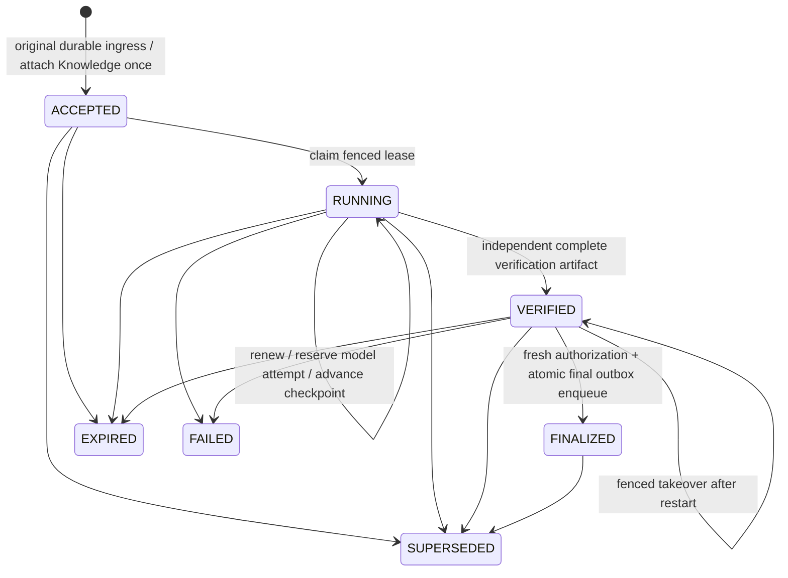
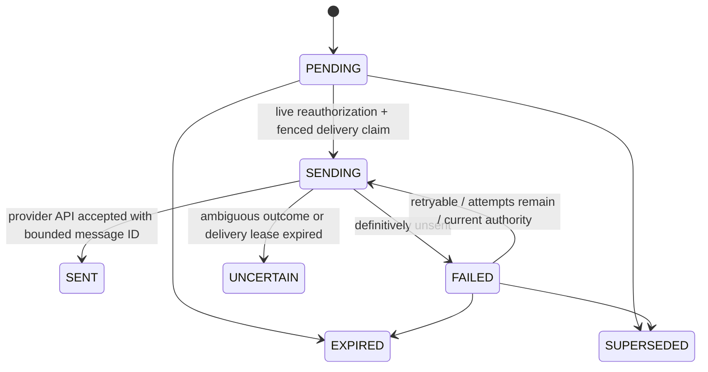

# Inactive Knowledge lifecycle foundation — Slice 1

This is a repository contract plus a deterministic transactional fake and an **unapplied SQL draft**, not a deployed durable worker. No existing engine, adapter, provider, transport, environment flag or deadline is changed. `FakeKnowledgeDatabase` is explicitly test-only; its serialized restart model is not a production persistence mechanism.

## Processing and delivery

Each notification has a separate delivery machine:

`SENT` means **API acceptance**, while `customerDelivery` remains `UNCONFIRMED`. There is no automatic transition out of `UNCERTAIN`. In-flight transport cannot be recalled when superseded; factual settlement of its result may still occur while its delivery lease is live. A lost lease cannot be settled or blindly reclaimed. No exactly-once remote delivery guarantee is made.

## Contract and safety boundaries

- Full scope: tenant, channel, provider account, conversation, event, immutable turn identity. Opaque provider event IDs retain their exact bounded punctuation; lossy diagnostic sanitization must never become an identity key. A conversation cannot be rebound to another account/channel.
- Event acceptance is idempotent and ordered under the conversation watermark. Non-Knowledge events also advance it. Duplicate old events cannot make old work current again. This is a dedicated Knowledge publication sequence, not a replacement for Booking or the P2 domain revision.
- Optional later Knowledge attachment supports the foreground action-first boundary. It uses the original acceptance, expiry and limits, and cannot attach after supersession/expiry. Only the future trusted preparation bridge may request that attachment after action handling; this foundation cannot attest that an appointment operation completed.
- Recoverable input is allowlisted: question <=4,000 characters, language code, <=4 history entries of <=1,200 characters each. Extra fields/config/credentials/callbacks are discarded. Nothing logs customer content or scope values. User content may itself contain sensitive text; retention/access control must protect it.
- Initial candidate expiry is 40,000 ms, with 30/35/40/60-second cases tested. Accepted configuration is bounded to 1,000–120,000 ms. The original ingress owns expiry, including foreground/queue delay. No claim, renewal, attachment, duplicate, retry or restart resets it. Supporting a configured limit here does not authorize any production deadline change.
- Run attempts default to 3 (maximum 5); model attempts default to 4 (maximum 8). Model attempt reservations must commit **before** provider invocation, even if a crash consumes a reservation without a completed call. Recovery may recompute work but cannot exceed these counters.
- Checkpoints are monotonic stage markers, not persisted extraction proposals. A restarted runner may need to recompute earlier work within remaining attempts. A fully verified artifact is retained, immutable and digest-bound, but is still insufficient authority for sending.
- Verified artifacts must identify the existing Evidence-first protocol, independent verification, complete required facts, bounded final text and 1–10 unique source/version references. These are **trusted backend attestations**, never evidence supplied by a customer. This slice does not perform verification. Binding these fields to the actual existing verifier is a mandatory future bridge; merely setting booleans is not verification.
- Fresh authority is a required dependency at both finalization and delivery. The future bridge must validate tenant/provider/conversation scope, every current source version, completeness/current result, and channel permissions. Exceptions fail closed and are not swallowed as optional telemetry. The fake rechecks ownership and expiry after the asynchronous dependency returns.
- Finalization and final outbox insertion are one transaction. Injected commit failure leaves neither a finalized task nor a sendable final entry. Progress/final deduplicate independently; finalization suppresses unsent progress. At most three explicitly unsent delivery attempts are supported; permanent failure exhausts them.
- `claimDelivery` is a claim contract, not transport invocation. Slice 2 must recheck current authority immediately before the external send, propagate cancellation, and account for the unavoidable gap between authorization and external side effect.
- There is no Booking capability in this interface, no engine/transport imports, no runner registration and no production repository implementation. All fake mutators share a database mutex across connections and commit a private copy together, modelling serializable transactions. Real PostgreSQL behavior is not established by these tests.

## SQL draft

`20261019081511_async_knowledge_lifecycle_slice1.sql.draft` was generated with the repository's Supabase CLI migration naming convention, then moved **outside** `supabase/migrations`. It is not discovered by normal migration application. Its approval guard rejects execution by default. No database was contacted or modified.

The draft extends existing P2 entities with namespaced Knowledge columns, leaving legacy status fields/Booking paths alone. It proposes:

- Schema/role/access preflight that refuses missing P2 base tables or incompatible identity types, client grants/column grants/policies.
- Immutable inbox acceptance/expiry and task identity/input/result guards.
- Event, task, turn and independent notification uniqueness; recovery indexes.
- Atomic ingress acceptance and optional later task attachment.
- One conversation-before-task locked transition RPC for claims, renewals, attempts, checkpoints, verified artifact capture, failure, atomic finalization, progress enqueue and delivery claim/settlement/recovery.
- Service-only SECURITY INVOKER functions, RLS, no new client policy or SECURITY DEFINER privilege escalation.
- Fresh trusted authority receipts (<=1 second old), bound to scope/turn/sequence/result digest. The application must obtain these from real checks, not a stored artifact. Receipt timing is a proposed scheduling bound, not a guarantee that external sources cannot change afterward.

The SHA-256 artifact frame is identical in TypeScript and the draft: protocol + LF + UTF-8 byte length + ':' + text + LF + source count + LF + ordered, length-framed ASCII source ID/revision pairs. JSON whitespace/key ordering does not affect it.

**Not database-validated.** No base P2 creation migration exists in this checkout. The draft assumes UUID primary IDs, bigint tenants and the columns/defaults in current P2 repository contracts; actual installed status constraints, defaults, keys, triggers, policies, grants and existing rows must be inspected before approval. Preflight refusal is deliberate, not authorization to replace the base schema or revoke a client-dependent workflow. Real concurrent acceptance, trigger behavior, rollback, role denial, lock ordering and RPC parity must be proven on an approved disposable PostgreSQL/Supabase fixture before moving this draft into migrations. That database test is not performed here because database writes/migration application are prohibited.

## Slice 2 prerequisites and rollback

Implement the real repository adapter and schema integration tests first. Then connect the existing verified-result/source bridge, Knowledge-only runner, lease renewal/cancellation, recovery scan and guarded outbound bridge. Prove all native adapters retain action-first frozen-history handling and existing mutation deduplication. No global P2 authority switch is needed or permitted by this foundation.

Before production activation: verify deployed P2 schema and backend privileges, approve/apply a reviewed migration separately, verify continuously available execution capacity, implement bounded retention/recovery, validate channel eligibility and provider acknowledgement semantics, and run controlled four-channel tests under separate approval. Current 20-second production Knowledge execution stays unchanged.

Local rollback is removal of the new isolated files/report directory. Existing tracked files are untouched. A future production rollback must stop new admission, explicitly drain/cancel tasks and preserve uncertainty records; it must not replay Booking or blindly resend pending artifacts.
