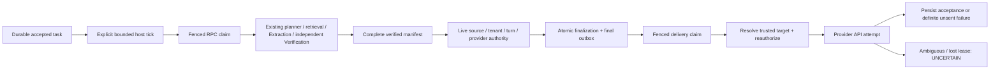

# Async Knowledge Slice 2 — inactive execution core

This is an offline implementation, not an activated native-channel async path. The repository, Knowledge-only executor, recovery cycle, current-source authority bridge and guarded delivery primitive are implemented. **End-to-end Slice 2 remains blocked on authenticated native ingress/provider-recipient binding and concrete delivery/eligibility composition.** No production flag, timer, worker, migration, message or environment setting was activated.

## Boundary and components

- `src/p2/supabase-knowledge-lifecycle-repository.ts`: service-side adapter for the two installed Knowledge RPCs. Scope/canonical conversation checks precede operations; RPCs retain the transaction/CAS boundary. Input and scopes are captured per request. Attempts, expiry, fences, event identity and finalization stay in PostgreSQL. Discovery is bounded to 16 by default (maximum 100); per-scope recovery scans at most 100 processing rows plus 100 sending rows. Generic P2 rows without a Knowledge turn identity are excluded. The adapter requires an already-created, correctly bound P2 conversation; it does not invent a native conversation/recipient mapping.
- `src/p2/knowledge-runner.ts`: bounded processing (default two per instance), 15s processing leases with periodic renewal, acceptance-relative cancellation, monotonic checkpoint markers, persisted attempt reservation, fresh-authority finalization and guarded final delivery. The actual remote provider outcome remains separate from persistence settlement. Unknown transport exceptions become ambiguous if settlement is possible, then the original exception is rethrown. API acceptance with failed settlement is returned explicitly and never retried as an unsent failure. Progress and altered artifact text cannot be sent as verified final text. Targets are allowlist-copied/frozen per turn.
- `src/p2/knowledge-worker-cycle.ts`: explicit, reentry-safe single host tick. It discovers durable work after a restart, processes within runner capacity, delivers newly finalized results without waiting for unrelated slower tasks, and recovers expired sends. No in-memory work queue, startup registration or recurring scheduler is installed. Settlement results are included in the cycle report; operational errors remain observable. Production must inspect unsuccessful settlements rather than ignoring the report.
- `src/p2/durable-knowledge-budget.ts`: explicit task-only InformationBudget subclass. It uses original database acceptance/expiry and recorded model attempts. The normal InformationBudget still caps the foreground path at 20s. No provider/model configuration changes.
- `src/p2/knowledge-authority.ts`: read-only live conversation/provider ownership and source-wide revision checks; `createDatabaseKnowledgeAuthority` reads the existing tenant-scoped Supabase Knowledge storage directly without an in-memory fallback. Both finalization and send check provider eligibility. A repeated watermark read follows async source/provider checks. The SQL then rechecks fencing, expiry, watermark and receipt freshness atomically. These are trusted backend composition dependencies, never webhook/model-provided booleans.
- `server.ts::executeDurableKnowledgeTask`: inactive Knowledge-only entry using the existing semantic planner, retrieval, strict source validation, Evidence-first Extraction/Verification, completeness, language/presentation rendering and source freshness guards. It does not call the Booking interpreter, calendars, mutation handlers or native send functions. Its history comes only from the frozen durable input. Model reservations occur immediately before actual provider invocation; the same verifier admission floor is rechecked after that async database reservation. Extraction completion gets a checkpoint before independent Verification starts.
- `src/ai/business-information-timing.ts`: optional original durable turn ID in the existing ALS scope. Normal callers retain random request-local IDs. Existing nonthrowing telemetry isolation stays intact.
- `knowledge.ts::knowledgeSourceRevision`: exports the same strict source revision calculation, replacing the existing identical inline non-document calculation. No changes to verifier rules or document revision semantics.

The first native acceptance/handoff and final concrete transport binding are deliberately **not shown as implemented**. Booking remains foreground and authoritative; recovery never invokes it.

## Trust and recovery limits

Only wire the executor to `executeDurableKnowledgeTask`, using a current tenant-scoped business configuration and `knowledgeTurnCurrent` from a trusted provider binding. Only wire finalization/delivery to the live database authority factory. An arbitrary executor returning serialized `independentlyVerified:true` flags is not an alternative verifier. The SQL result is a service-side attestation from an earlier real verifier execution; flags or stored prose alone never grant current publication authority.

Fresh execution requires every unit ENTAILED, every requested facet VERIFIED/aligned/materially complete, every obligation COVERED, current evidence and unexpired/current ownership. A canonical presentation fallback can retain all these properties: skipping optional composition must not discard a complete verified answer. Empty/partial/unverified factual fallbacks cannot become final lifecycle results.

Checkpoint names are markers, not cached planner/evidence/unit artifacts. Recovery before VERIFIED recomputes the existing Knowledge path within the original remaining time and persisted model allowance. It can run out of time/attempts; it never resets limits. Recovery after VERIFIED repeats current source/provider/turn authorization without another always-on model call. Model work already sent to an uncancellable provider can finish after lease loss; database fences prevent stale publication. OpenAI cancellation is propagated where supported; the existing Gemini invocation does not provide physical cancellation guarantees.

Provider API acceptance is not customer delivery. A lost settlement or expired send lease becomes UNCERTAIN and must not be automatically retried. An inbound supersession cannot recall a request already submitted to a remote provider. Exact final text is checked against the verified task result before transport; no waiting messages are sent in this slice.

## Remaining binding blocker

The approved P2 acceptance RPC stores bounded question/language/history; inbox payload is empty and final outbox recipient_key is an opaque conversation reference. These are insufficient to reconstruct the native recipient after process loss. A canonical conversation key must never be sent as a recipient. Existing native transport helpers also depend on current request-local publication state and return booleans, which cannot truthfully represent provider acceptance versus ambiguous failure for recovery.

`KnowledgeProviderAuthority` and `GuardedKnowledgeTransport` therefore remain **unbound server ports**. Fake ports in tests are not actual WhatsApp/Telegram/Instagram/Messenger eligibility implementations. No real native async event acceptance, durable recipient binding, current permission-window check or background send is installed. The old native regression suites establish old-path preservation, not async-native parity. No claim is made that the current Render process already starts/restarts this cycle or supports an adequate shutdown window.

The minimum next task is an independently reviewable authenticated native handoff: preserve a bounded tenant/account/connection/recipient reference from the already-authenticated and deduplicated provider event, provision/validate the scoped P2 conversation, register original ingress, then attach only the independent information clause after foreground action completion using pre-action history. Replace Knowledge dispatch exactly once at the shared boundary **before** the existing retrieval/planner starts; adding a callback after that work would duplicate it. Extract/bind raw provider dispositions without relaxing the current request-local guards or interpreting existing `false` returns as definitely unsent. Do not complete unrelated Release 2 routing work or activate anything as part of that extraction.

## Offline timing and rollout proposal

The validation report contains intercepted-provider virtual-clock simulations, not production measurements. They preserve the 20s per-provider cap, 1.5s publication reserve, 6s verifier floor, original acceptance-relative expiry, modeled lease renewal, three proposed factual units, optional 300ms composition and a 500ms simulated provider API call. Source/receipt/database network latency and actual customer receipt are not measured. Longer expiry is not a success guarantee.

Candidate for a separately approved pilot: 40s total from durable acceptance, concurrency two per instance, existing provider limits unchanged, 15s processing lease/5s heartbeat, bounded discovery. No flag or setting is changed now. Future default-off admission/processing/delivery gates must be separately controlled. Before any live gate: complete the bindings above, prove four-channel async-native parity with intercepted providers, validate current platform permissions/windows, confirm host startup/shutdown behavior, measure queue/authority/settlement latency and host/database clock skew, and prevent the original foreground Knowledge path from executing the same branch. The SQL authority receipt has a strict 1s freshness window: clock skew/network delay must fail closed, not be bypassed.

Official migration-history reconciliation remains separately approved work. Do not run migration tooling that could replay the manual DDL.

Rollback now: reverse only the Slice 2 patch after checking it against the captured baseline; preserve Release 1/P1, partial Release 2, Slice 1 and every prior report. No database rollback is needed. After a future activation: stop admission first, stop/cancel workers where supported, settle/drain authorized in-flight work, preserve all uncertain sends, and leave the schema/data intact. Never replay Booking or blindly resend UNCERTAIN rows.

Smart Waiting is deferred. The next waiting-specific step, after the native binding blocker, is a nonblocking provider activity capability using the same authorized target and independently deduplicated progress identity. It must not precede/block Verification or add a presentation model call.
