# Native async integration — offline implementation

## Execution boundary

The authenticated, resolved native entries capture real provider event order and recipient/account context. Shared ingress calls Ordered Admission V2 before interpretation, Booking or Knowledge work. Stale and duplicate events stop. Unknown/tied ordering never falls back to V1. For existing Evidence-first eligible information requests, the shared prepared-turn boundary executes authorized actions first, then attaches the informational clause with frozen pre-action history. Foreground Knowledge does not execute the same clause. Existing configured/catalog/services/prices/hours/contact/policy handling remains foreground because the durable executor does not support that protocol.

```mermaid
flowchart LR
 A[Authenticated native entry] --> B[Signed recipient binding + ordered V2 admission]
 B --> C[Existing preparation and foreground Booking]
 C --> D[Attach Knowledge clause and frozen history]
 D --> E[Fenced durable recovery runner]
 E --> F[Independent verification and completeness]
 F --> G[Current source, tenant, turn and provider authorization]
 G --> H[Fenced outbox claim]
 H --> I[One raw provider POST]
 I --> J[API accepted / definitely unsent / uncertain]
```

## Recovery and authorization

`knowledge_native_recipient_v1` stores the minimum recipient/account/connection identity and a keyed integrity signature in existing conversation metadata. It never stores provider tokens. Conflict-ignore insertion preserves `knowledge_native_order_v2`. Recovery checks the signed canonical conversation, current tenant-owned connection, account, credential expiry and original inbound event proof. Credentials are reloaded from existing connection records. Canonical ownership remains resolvable during credential revocation so expiry and fencing can proceed.

Meta requires normalized current connections; legacy global credential fallback is not background authorization. Telegram additionally supports the existing tenant-owned bot credential. Only ordinary private Telegram bot chats are supported; groups/business connections fail closed. Meta supports only the standard 24-hour response window, without templates, tags or extensions. WhatsApp checks current token/application/scopes, WABA phone membership and phone health. Instagram/Messenger check current account identity, messaging access and both conversation participants; Messenger also requires `can_reply`. Unsupported provider response shapes fail closed. Intercepted responses validate implementation behavior, not actual account permissions or provider availability.

Source revision/tenant/current-turn authorization is checked through the existing trusted authority, including immediately before transport. Restart does not replay Booking. Previous durable question/answer context is recovered only from the immediately preceding finalized task with a matching API-accepted final outbox artifact; this context never constitutes factual evidence.

## Delivery and host controls

The raw transport preserves existing foreground helpers. Provider acceptance requires a provider-specific response identity, not just HTTP 200. Network, malformed and ambiguous server outcomes become UNCERTAIN and are not blindly retried. API acceptance does not establish customer receipt. Definitively unsent outcomes use bounded lifecycle retry policy.

Independent controls default false: `ODINLINK_ASYNC_KNOWLEDGE_ADMISSION`, `ODINLINK_ASYNC_KNOWLEDGE_PROCESSING`, `ODINLINK_ASYNC_KNOWLEDGE_DELIVERY`. `ODINLINK_ASYNC_KNOWLEDGE_EXECUTION_MS` defaults to 20000; only 20000/30000/35000/40000 are accepted. No environment or production deadline was changed. Startup creates no recurring work unless processing or delivery is explicitly enabled. Polling is bounded, nonoverlapping, with concurrency two and durable discovery of sixteen. Shutdown cancels recovery/delivery and fences stale work. Gemini work may remain physically uncancellable; expiry, attempts and leases still prevent stale publication. Recovery can repeat interrupted model work within persisted attempt limits.

## Activation prerequisites and rollback

NO-GO for live activation in this task. Ordered V2 remains an unapplied additive SQL draft. Separately approve and validate that migration; do not replay manually applied Foundation/Extension or reconcile history implicitly. Confirm current connection schema, stable shared HMAC secret, real provider endpoint shapes/permissions and delivery windows for each account. Validate fresh-read latency and lease/delivery headroom using controlled, separately authorized tests. Simulated API responses do not prove live delivery or higher answer reliability.

Enable admission, processing and delivery separately only after those gates. Start with a tightly bounded tenant cohort and explicit expiry configuration. Roll back by disabling admission first, then delivery/processing and allowing fenced shutdown; retain pending/uncertain rows for investigation. Never replay Booking or blindly resend uncertain items. Credential/key changes fail closed and require a drain/rebinding procedure. No Smart Waiting is implemented.

One next action: review this isolated patch and obtain separate authorization for Ordered Admission V2 migration preflight/application. Controlled live validation remains deferred.
