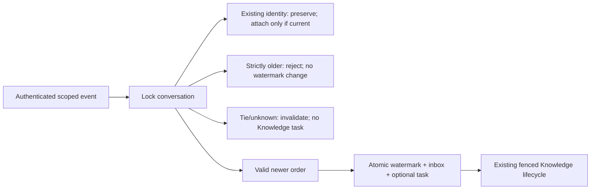

# Ordered native Knowledge admission v2 — inactive, unapplied

This component corrects admission ordering, not the remaining native async handoff. No native entry or host starts it. No model, verifier, Booking, transport, deadline, environment setting or pinned migration is changed. The new SQL draft is outside `supabase/migrations` and needs separate execution approval.

## Root cause and boundary

V1 advances a conversation's Knowledge ownership for each distinct event in database arrival order. A delayed worker can therefore supersede newer provider work. V2 compares trusted native order and accepts/rejects/attaches under the **same conversation row lock**. Existing `knowledge_sequence` remains the publication invalidation fence; it is not evidence of native chronology. Existing processing and delivery RPCs continue to enforce this fence.

`odin_accept_knowledge_turn_v2(bigint, uuid, text, text, text, text, jsonb, jsonb, integer, integer, integer)` takes tenant, conversation, channel, provider account, exact event ID, trusted canonical conversation key, native order, optional bounded Knowledge input, and the existing limits. The order is exactly `{atMs: integer, sequence: integer|null}` or SQL NULL. It returns `disposition`, `mayAttach`, `inserted`, `inbox`, and `task`.

`SupabaseOrderedKnowledgeRepository.acceptOrdered(...)` exposes a discriminated result with the original durable identity when present. Its plain `accept()` refuses use; missing v2 RPC/permission/database failures never fall back to v1. Input/scope/order are snapshotted before asynchronous access. Admission statuses govern Knowledge only: they neither authorize mutations nor replace the foreground Booking decision/deduplication path. STALE/AMBIGUOUS/BLOCKED must not trigger a fallback into competing foreground Knowledge planning. Current source/tenant/provider authority and verification remain required downstream. The base repository changes only five members from private to protected to reuse its scope/result/task validation; existing v1 behavior is otherwise unchanged.

Ordering metadata is a **trusted backend attestation** captured after authentication, provider account resolution and inbound deduplication. Neither SQL nor the capture helper authenticates a webhook. Do not accept order from customer text, a model, API clients or arbitrary request parameters. Exact provider identities remain deduplication keys, never numeric or lexical tie breakers.

## Native signals and deliberately partial ordering

| Channel | Actual existing entry fields | Rule |
| --- | --- | --- |
| Telegram | `update.update_id`; `update.message.date` (Unix seconds) | Compare provider event time; within the same second use the documented update sequence. Contradictory time/sequence observations fail closed. |
| WhatsApp | `message.timestamp` (Unix seconds string); `message.id` only for identity | Strictly greater provider timestamp is newer. Distinct events sharing a second are ambiguous. Never sort `wamid` values. |
| Instagram | `webhook_event.timestamp` (milliseconds); `message.mid` only for identity | Strictly greater event time is newer. Distinct equal timestamps are ambiguous; echoes must be excluded before admission. |
| Messenger | `webhookEvent.timestamp` (milliseconds); `message.mid` only for identity | Same conservative timestamp-only rule; no inference from recipient IDs or `mid` order. |

Field usage was traced in `server.ts` (Telegram register/date at 25377–25401, WhatsApp at 29154–29160, Messenger at 30573–30576, Instagram at 31230–31233). `nativeKnowledgeOrder` reads exactly these existing shapes; it does not wire the entries or copy message bodies. Synthetic fixtures exercise all four shapes with six languages; this is field-level coverage, not async native routing parity.

Telegram documents sequential `update_id` and a random next ID after at least a week without updates ([official Bot API](https://core.telegram.org/bots/api#update)). Therefore v2 does not compare IDs across unbounded epochs: timestamp progress of at least seven days permits a lower sequence. A lower/equal sequence with advancing time inside seven days, or a higher sequence with regressing time, latches BLOCKED. An event-ID collision across a reset cannot be silently treated as a new turn; existing identity is retained and mismatching order cannot attach work. Future integration must fail closed/review such collisions instead of inventing an epoch.

Meta provides timestamp fields, not a total sequence in these entry shapes. This implementation deliberately offers a **partial order**, not a universal guarantee of human send order, client-clock correctness, or completeness of all future webhook arrivals. Primary Meta reference endpoints returned HTTP 429/unavailable during this task; current field units were independently checked against the existing native implementation and earlier validated fixtures, not newly observed live traffic. Relevant references: [WhatsApp webhook components](https://developers.facebook.com/docs/whatsapp/cloud-api/webhooks/components/), [Messenger message events](https://developers.facebook.com/docs/messenger-platform/reference/webhook-events/messages/), [Instagram webhooks](https://developers.facebook.com/docs/instagram-platform/webhooks/). Confirm the actual enabled API products/payloads before any live activation. No third-party claim was substituted as a total-order guarantee.

## Admission outcomes

- **ACCEPTED:** New, valid, strictly advancing order (or first order in a fresh conversation). Persist native watermark and event identity atomically. Optional Knowledge input creates one task.
- **DUPLICATE:** Preserve the original turn, acceptance, expiry, limits and task. Attachment is allowed only while current, unexpired, ACTIVE, previously accepted, and carrying exactly the same order. A stale duplicate returns its identity with `mayAttach:false`; it cannot restore ownership or attach a task.
- **STALE:** A strictly older distinct event creates no inbox/task and changes neither native watermark nor ownership fence. Retrying it remains stale. Rejected events have no new durable task identity.
- **AMBIGUOUS / TIED:** A distinct equal timestamp without a reliable tie breaker records a nonsendable ingress identity and advances the invalidation fence to suppress already pending/processing replies. No task is created. No native winner is invented. A strictly later valid timestamp can clear TIED; more events in that same timestamp interval cannot.
- **AMBIGUOUS / BLOCKED:** Missing/unusable order, future provider time, or contradictory Telegram metadata records a nonsendable identity and invalidates prior work. The last usable native watermark is retained where possible. BLOCKED cannot automatically clear. Later distinct events return BLOCKED without tasks until a separately reviewed resynchronization procedure is authorized. This sacrifices availability rather than falsely asserting order. There is no reset RPC or automated bypass in this slice.

Missing timestamps never become receipt time. Nonintegral, wrong-resolution, unsafe integers and unexpected structured fields are rejected. The field capture helper returns NULL for malformed order so the trusted entry can invoke the invalidation/latch behavior. Malformed direct service calls fail transactionally; they are not accepted native turns.

Once an ambiguity is observed, current work is fenced. A reply already accepted by a provider before a later event/ambiguity becomes known cannot be recalled. This is not an exactly-once remote-delivery or unseen-event guarantee.

## Persistence, security and compatibility

No new tables/columns/indexes are needed. V2 reserves `odin_conversations.aggregate_meta.knowledge_native_order_v2`: state, provider time, optional sequence and owner fence (fixed bounded fields). The inbox's existing payload retains only bounded order/disposition; Telegram's existing `turn_sequence` also records the sequence. Existing unique tenant/channel/account/event identity and tenant/conversation FKs remain authoritative. Question/history stay only in the existing bounded task payload.

Three narrowly scoped guards protect enrolled conversations: ownership changes must update the order fence atomically; reserved inbox order cannot be rewritten; a task cannot attach to ambiguous or noncurrent ingress. An old v1 distinct-event admission on a v2 conversation fails transactionally instead of bypassing ordering. The v1 function definition and ACL are unchanged. Generic unenrolled P2/v1 conversations remain compatible. Older v1 conversations already holding Knowledge sequence without native order are rejected for enrollment and require a separately reviewed drain/resynchronization; no backfill invents order.

All new functions are SECURITY INVOKER with a fixed search path and EXECUTE revoked from PUBLIC/anon/authenticated, granted only to service_role. Existing table RLS/client policies/grants are unchanged. These guards protect backend mistakes; a fully privileged database operator remains a trusted principal.

Migration order: already-installed Foundation → already-installed Slice 1 → separately approved v2 draft only. The draft has an explicit approval guard, transaction, 5s lock timeout and 30s statement timeout; reruns/partial conflicts fail. It creates functions and triggers, with no data rewrite or booking object changes. Trigger creation still locks the three target P2 tables and can block concurrent writers; this is not lock-free. Future application needs a quiet, separately authorized operation, exact payload/hash review and read-only postchecks. Manual Foundation/Extension history reconciliation remains separate; never replay them.

Uses PostgreSQL 17-era core JSONB, row locks, triggers and PL/pgSQL; tested on disposable 17.11, not hosted 17.6. No changed feature from the inspected [Supabase 17.11 changelog](https://supabase.com/changelog/postgres-15-19-17-11-breaking-changes) is required by this draft. Hosted gateway privileges/schema-cache visibility, actual deployed catalog compatibility and application clock/payload behavior still need a future approved preflight.

## Rollback and next integration step

Nothing is active now. Before future activation, complete authenticated native handoff and durable recipient/account binding, current connection/token/permission/window checks, raw transport outcomes, and separate default-off admission/processing/delivery startup/shutdown controls. Do not infer a recipient from the HMAC key or reinterpret foreground boolean failures as definitively unsent.

**Next precise task:** connect the authenticated/deduplicated native context to `acceptOrdered` before foreground actions can race with other turns, then attach only the independent information branch before Knowledge planning, using frozen pre-action history. Bootstrap a validated durable recipient/connection binding without overwriting the reserved order metadata. Keep Booking foreground and never replay it during recovery. Exercise actual four native entries, not only injected ports, before claiming async parity.

A future rollback stops ordered admission and processing/delivery, preserves durable order and uncertain sends, and leaves enrolled conversations fenced. Do not switch those conversations back to v1 or delete their reserved watermark to make traffic work. No automatic destructive SQL rollback or resynchronization is provided.

This component is ready for code/SQL review; migration application and controlled live async validation are **not** authorized or ready. See the task validation report for exact results and isolated diff.
