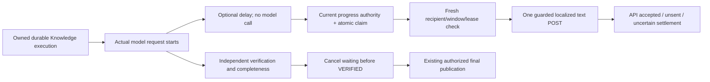

# Smart Waiting — minimal guarded-text release

## Scope and behavior

One optional coordinator per runtime observes the existing durable executor's actual extraction/independent-verification requests. It creates no planner/model call, queue, worker, table or migration. It runs only for an owned, durably accepted Knowledge task, never foreground Booking. The server starts the existing provider request before notifying the optional hook. Already available planner facet labels select only closed fact-free topic phrases; the existing read-only topic recognizer supports literal multilingual facets. It does not authorize actions or publish facts.

`ODINLINK_SMART_WAITING` must equal `true`; absent is off. `ODINLINK_SMART_WAITING_DELAY_MS` defaults to 5000, accepts integer 1000–10000. Invalid optional settings disable waiting without breaking Knowledge. Existing async processing AND delivery controls must also be on. This flag alone starts no host work. No environment settings were changed. The existing 20-second default is unchanged.

The first confirmed extraction or verification stage arms one timer. Updates retain that timer and use the latest confirmed stage/topic; they do not create repeated notifications. Fast completion cancels it. End-of-operation hooks clear the active phase, including during pending progress authorization; idle/completed phases cannot initiate transport. If the delay fires between operations, a later confirmed operation may arm a fresh delay. Less than four seconds of original task lifetime remaining suppresses an attempt. There is no ETA prediction; final completion cancels waiting before recording VERIFIED. Lease loss, expiry, shutdown and supersession cancel or reject optional work through the existing abort/fencing/current-turn mechanisms. No final path awaits progress generation, provider response or settlement.

## Wording

Six reviewed language sets: English, Swedish, German, Spanish, Persian and Arabic. Each has three variants for extraction and verification, with parking/location/general-question noun phrases (108 combinations). It uses the task's existing detected language, region-code normalization and actual stage, without echoing customer/document text. Unknown language skips optional feedback. Unknown topic uses the restrained question phrase. No findings, percentage, calendar claim, booking confirmation, ETA or promise of final arrival is generated.

Variant selection rotates with conversation sequence and avoids the previous selection for the same tenant/channel/language in a 128-entry process-local LRU. Durable retries reuse the exact original approved outbox text only when it also matches the currently active phase; otherwise optional feedback is skipped rather than describing an operation that has not started. No global cross-instance nonrepetition guarantee is claimed; semantic/delivery correctness never depends on that LRU. This deliberately limits free-form wording to avoid extra inference/capacity/latency or unverified claims. Website/Voice can reuse the fact-free presentation policy; Voice turn holding and new adapters are not implemented.

## Native capabilities and fallback

| Channel | Implemented feedback | Preserved eligibility |
|---|---|---|
| WhatsApp | One short text acknowledgement through existing raw messages API | Signed recipient/current connection, token/app/scopes, WABA phone ownership/health and standard response window |
| Telegram | One short text acknowledgement through existing raw sendMessage API | Current tenant bot identity, ordinary private recipient/chat access; no invented Meta window |
| Instagram | One short text acknowledgement through existing raw messages API | Current connection/account/message permission, conversation participants and standard window |
| Messenger | One short RESPONSE acknowledgement through existing raw messages API | Current page/account/message permission, participants, can_reply and standard window |

Native activity is **not enabled** by this release's validated delivery adapter. For example, Telegram documents boolean success for `sendChatAction`, whereas the durable API_ACCEPTED message outcome requires an actual provider message ID. Fabricating an outbound ID or recording successful activity as a failed message would misrepresent the outcome. Meta read-receipt/sender-action contracts are also not interchangeable with text-message receipts. The implementation therefore uses the requested supported text fallback on every channel. It does not probe unsupported activity endpoints, incur an extra sequential activity call or claim that native typing was implemented. A later activity adapter needs separately reviewed receipt semantics; no extra database change is required for this guarded-text release.

Reference: [Telegram sendChatAction](https://core.telegram.org/bots/api#sendchataction). Existing provider checks remain fail closed; intercepted fixtures do not establish actual live account permissions or customer delivery.

## Durable safety and cancellation

The existing `NativeKnowledgeProgressAuthority` and **unchanged** Progress Safety V1 RPC/trigger are mandatory. The authority reloads the current task, tenant, signed binding, connection, channel eligibility, processing owner/fence and checkpoint. The atomic RPC serializes with finalization, preserves original expiry/attempts and distinct progress/final identity, and rejects claims after verification/finalization. The coordinator accepts only its reviewed presentation texts when recovering a stored acknowledgement. Altered/legacy unapproved text is not dispatched.

`dispatchTarget` returns the current server-only connection as well as recipient after reauthorization; credentials are never persisted or included in telemetry. Raw outcomes reuse the existing provider-specific transport, never foreground boolean helpers. API acceptance is distinct from customer receipt. Unknown network outcomes become UNCERTAIN; no blind retry. There is at most one attempt per local execution and one accepted progress message per durable task. Definitively-unsent retries on recovery remain bounded by the existing contract and reuse wording.

A claimed operation cancelled before transport settles definitively unsent/nonretryable when possible. A request already transmitted can complete after finalization and settles factually within its lease; it cannot be recalled. No physical remote arrival-order or exactly-once guarantee is made. Settlement failure is logged without retrying a potentially accepted POST. Source revocation/failed verification still prevent the factual final answer; waiting text grants no factual authority.

Optional work has at most two outstanding I/O jobs per runtime, one timer per active task, bounded language-choice memory, and no mandatory AI call. Provider eligibility receives bounded abort signals; not every database/SDK call is physically cancellable. No external I/O is inside the atomic claim transaction. Shutdown cancels optional work and uses the existing bounded grace period to drain it. Final publication never waits for that drain.

Diagnostics use waiting-prefixed stages, task-local UUID/channel and bounded outcome enums. No message, document, recipient, credential or provider exception body is logged. Optional errors/throwing observers cannot replace model, verifier or final transport results.

## Migration and release gates

Progress Safety draft remains unapplied by this task:

`../knowledge-progress-safety-v1/progress-safety-v1.sql.draft`

SHA-256 `d93ee49ec845dcef99abc8e0f5e663b04b32a4338dc83809f85720e394aa8b04`.

No SQL modification/addition is needed. Tests apply the exact draft only to disposable PostgreSQL and exercise real native entries, signed recovery, claims, finalization and settlement. Foundation/Slice 1/Ordered V2 are prerequisites and must not be replayed. Manual migration history reconciliation remains separately authorized work, not implicit CLI tooling.

**GO to include this minimal guarded-text implementation in the reviewed release with all controls disabled. NO-GO to activate it yet.** Shortest release path: separately preflight/review/authorize/apply Progress Safety V1 and read-only verify; deploy the reviewed application with admission/processing/delivery/waiting off; obtain explicit controlled account/tenant validation authorization and verify actual connection eligibility/headroom before enabling any relevant controls. Do not infer current production installation or runtime configuration from local fixtures.

Rollback: turn waiting off first; it creates no new claim/timer and final-only behavior continues. Preserve/settle genuine in-flight operations, quarantine uncertainty, and retain the progress safety guard. Disable broader async controls only under their existing rollback procedure. Do not drop objects, replay Booking or resend uncertain messages automatically.

See `../../validation/complete-smart-waiting-2026-10-19/README.md` for exact patch, test counts, timing evidence and limitations.
